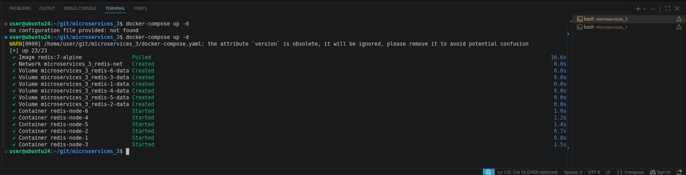
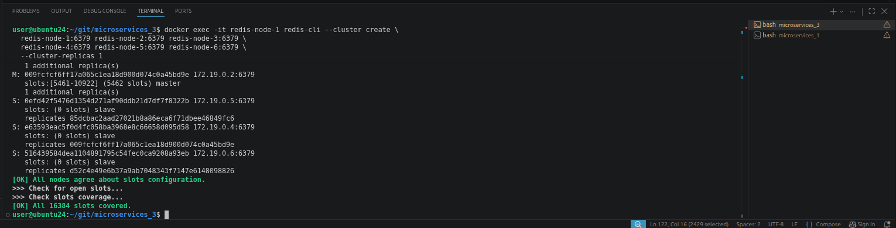
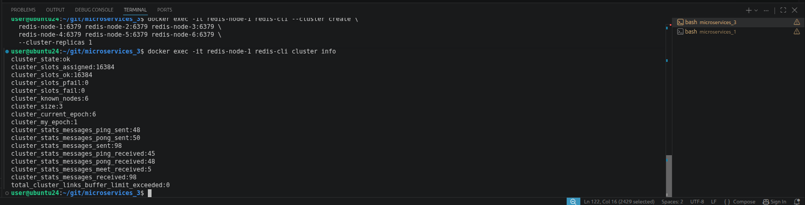
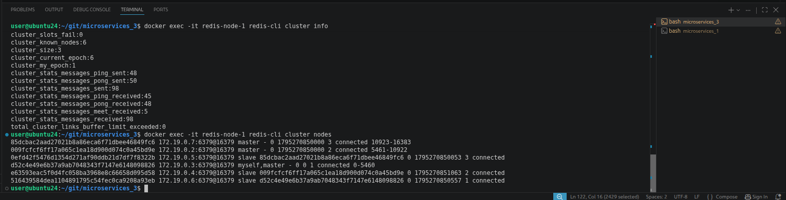
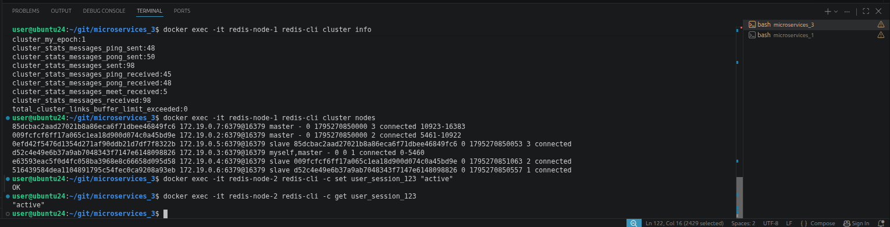
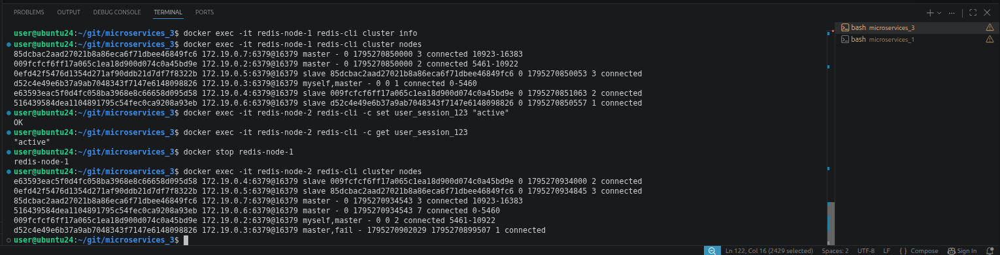
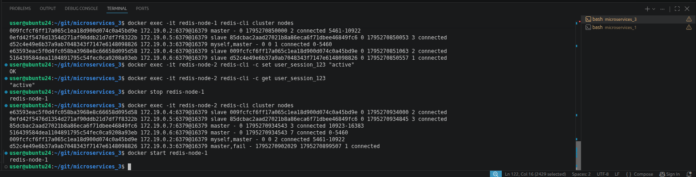

# Домашнее задание к занятию «Микросервисы: масштабирование» - Старцев Данила Антонович

Вы работаете в крупной компании, которая строит систему на основе микросервисной архитектуры.
Вам как DevOps-специалисту необходимо выдвинуть предложение по организации инфраструктуры для разработки и эксплуатации.

## Задача 1: Кластеризация

Предложите решение для обеспечения развёртывания, запуска и управления приложениями.
Решение может состоять из одного или нескольких программных продуктов и должно описывать способы и принципы их взаимодействия.

Решение должно соответствовать следующим требованиям:
- поддержка контейнеров;
- обеспечивать обнаружение сервисов и маршрутизацию запросов;
- обеспечивать возможность горизонтального масштабирования;
- обеспечивать возможность автоматического масштабирования;
- обеспечивать явное разделение ресурсов, доступных извне и внутри системы;
- обеспечивать возможность конфигурировать приложения с помощью переменных среды, в том числе с возможностью безопасного хранения чувствительных данных таких как пароли, ключи доступа, ключи шифрования и т. п.

Обоснуйте свой выбор.

Выбор решения: Kubernetes
Для обеспечения развёртывания, запуска и управления приложениями в микросервисной архитектуре предлагается использовать Kubernetes. Это зрелая платформа оркестрации контейнеров, которая на сегодняшний день является де-факто стандартом в индустрии: по данным CNCF, 82% организаций используют её в production, тогда как Docker Swarm сохраняет около 24% использования, в основном в небольших инфраструктурах.

Kubernetes полностью закрывает все заявленные требования.

Поддержка контейнеров. Kubernetes работает с контейнерами OCI (Docker, containerd, CRI-O) и управляет ими через абстракции Pod, Deployment, StatefulSet.

Обнаружение сервисов и маршрутизация запросов. Для внутреннего обнаружения используется встроенный DNS (CoreDNS) и объекты Service. Когда поды масштабируются или перезапускаются, их IP-адреса меняются, но Service предоставляет стабильную точку входа и автоматически обновляет список эндпоинтов. Для внешней маршрутизации используется Ingress (например, на базе NGINX Ingress Controller или Traefik), который выполняет роль API Gateway и балансировщика.

Горизонтальное масштабирование. Достаточно изменить поле replicas в Deployment или выполнить kubectl scale. Kubernetes сам распределит новые поды по узлам кластера.

Автоматическое масштабирование. HorizontalPodAutoscaler (HPA) автоматически увеличивает или уменьшает количество подов на основе метрик CPU, памяти или кастомных метрик (например, длины очереди или RPS), которые поставляет Prometheus Adapter.

Явное разделение ресурсов, доступных извне и внутри системы. Это достигается на нескольких уровнях:

Сеть: NetworkPolicy позволяют ограничить, какие поды могут общаться друг с другом, а какие — доступны извне.

Ресурсы: ResourceQuota и LimitRange задают лимиты на потребление CPU и памяти для неймспейсов и отдельных контейнеров.

Доступ: Ingress контролирует внешний трафик, а Service — внутренний.

Конфигурация через переменные среды и безопасное хранение секретов. Для нечувствительных данных используются ConfigMap, которые можно монтировать как переменные среды или файлы. Для паролей, ключей доступа и токенов предназначены Secret. Хотя стандартные Kubernetes Secrets хранятся в base64 и не шифруются по умолчанию, в production-среде используется интеграция с внешними хранилищами: External Secrets Operator синхронизирует секреты из HashiCorp Vault, AWS Secrets Manager или GCP Secret Manager, что исключает их хранение в манифестах и etcd в открытом виде.

Альтернативы. Docker Swarm проще в установке и подходит для небольших кластеров (до ~1000 узлов), но уступает Kubernetes по экосистеме, гибкости автомасштабирования и управлению секретами. HashiCorp Nomad легче и лучше работает со смешанными нагрузками (контейнеры + виртуальные машины), но для реализации типовых паттернов микросервисов (Ingress, HPA, External Secrets) требует дополнительной интеграции сторонних инструментов. Для крупной компании с долгосрочными планами развития Kubernetes даёт наибольшую готовность «из коробки» и поддерживается всеми облачными провайдерами.

## Задача 2: Распределённый кеш * (необязательная)

Разработчикам вашей компании понадобился распределённый кеш для организации хранения временной информации по сессиям пользователей.
Вам необходимо построить Redis Cluster, состоящий из трёх шард с тремя репликами.

### Схема:

---

### Как оформить ДЗ?

Выполненное домашнее задание пришлите ссылкой на .md-файл в вашем репозитории.

---